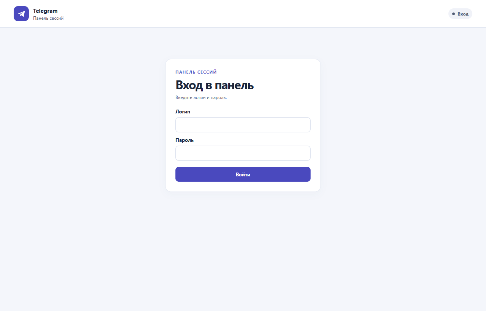
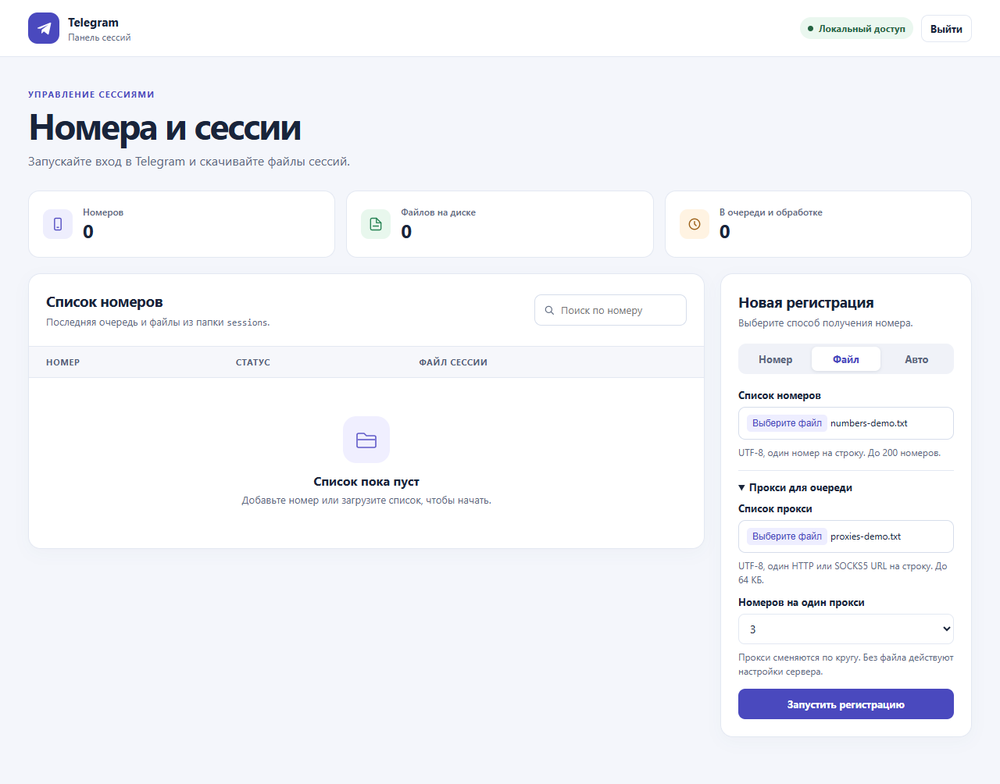

# Регистрация и вход в Telegram

## Запуск в Docker

Нужен Docker Compose с Linux-контейнерами. Скопируйте шаблон настроек в
`.env` и задайте в нём `PANEL_USERNAME` и `PANEL_PASSWORD`. Пароль должен
содержать от 12 символов.

```powershell
Copy-Item .env.example .env
# Заполните .env перед запуском.
docker compose up -d --build
```

Откройте [http://127.0.0.1:8765](http://127.0.0.1:8765) и войдите с логином
и паролем из `.env`. `PANEL_PORT` меняет внешний порт.
Compose передаёт пароль в контейнер как секрет. Список номеров и скачивание
файлов доступны после входа. Вход действует 12 часов или до выхода из панели.

`DEVICE_TOKEN`, `PANEL_PROXY` и `PANEL_PROVIDER` задаются в `.env` при
необходимости. Для авто режима укажите, например,
`PANEL_PROVIDER=my_provider:open_provider` и пересоберите образ после добавления
`my_provider.py`. Модули из папки `providers/` тоже включаются в образ.

Файлы `.session` хранятся в томе `telegram_sessions` и сохраняются при
перезапуске и пересоздании контейнера. Если сессии уже лежат в локальной папке
`sessions`, после первого запуска их можно перенести в том при пустой очереди.

```powershell
docker compose cp .\sessions\. panel:/app/sessions/
docker compose exec --user root panel chown -R panel:panel /app/sessions
```

## Запуск без Docker

Требуются Python 3.13+ и Git. Установите зависимости командой
`python -m pip install -r requirements.txt`. Токен устройства читается из
`DEVICE_TOKEN`. Сессии хранятся в `sessions/reg_<номер без плюса>.session`.

## Ручной режим

```powershell
python main.py
python main.py manual --phone "+12345678901"
python main.py manual --file .\phones.txt
```

`python main.py` запрашивает следующий номер после завершения текущего.
Enter на запросе номера завершает программу. Файл принимается в UTF-8
с BOM или без него, по одному международному номеру на строку. Пустые строки
игнорируются, дубликаты после нормализации удаляются с сохранением порядка.
Некорректная строка останавливает запуск до обращения к Telegram.

Код запрашивается для текущего номера. Enter пропускает этот номер,
при неверном коде доступны три попытки. Имя нового аккаунта и пароль 2FA
вводятся по запросу. Прокси можно менять каждые 2–5 номеров, по умолчанию
каждые 4. Enter оставляет текущий прокси, `-` включает прямое соединение.

## Автоматический режим

### HeroSMS

Задайте `HEROSMS_API_KEY` и числовой `HEROSMS_COUNTRY` в переменных окружения.
Если ID страны пропущен, используется `0`. Адаптер запрашивает номера для
Telegram с кодом сервиса `tg`.

```powershell
python main.py auto --provider providers.hero_sms:open_provider --count 1 --code-timeout 120
```

Для веб-панели запустите `python web_panel.py --provider providers.hero_sms:open_provider`
и выберите «Авто». При запуске через Docker задайте
`PANEL_PROVIDER=providers.hero_sms:open_provider`, `HEROSMS_API_KEY` и
`HEROSMS_COUNTRY` в `.env`.

HeroSMS разрешает отмену через две минуты после покупки. Если запрос отмены
отклонён, панель и CLI покажут, что провайдер не подтвердил завершение активации.
Проверьте её статус в кабинете HeroSMS. После обрыва связи при покупке адаптер
не повторяет запрос автоматически. [Правила HeroSMS](https://hero-sms.com/ru/rules)

### Свой провайдер

```powershell
python main.py auto --provider my_provider:open_provider --count 5 --code-timeout 120 --first-name "Alex"
```

`my_provider:open_provider` — пример имени вашей интеграции. Фабрика возвращает
асинхронный контекстный менеджер, который открывает и закрывает ресурсы адаптера.
Например, её можно определить через `@contextlib.asynccontextmanager` и
выдать адаптер через `yield`. `--count` задаёт число последовательных попыток.
`--proxy` принимает HTTP/SOCKS5 URL для Telegram и Mail.tm.

Адаптер реализует `NumberProvider` из `number_provider.py`.

- `acquire_number()` возвращает `Activation(phone, reference)`, где
  `reference` — идентификатор конкретной активации у провайдера.
- `wait_for_code(activation, challenge)` ждёт код для этой активации.
  `challenge.delivery` и `challenge.length` описывают канал и длину кода.
  Код возвращается строкой, чтобы сохранить ведущие нули. Если провайдер
  завершил активацию без кода или канал ему недоступен, верните `None`.
- `finalize(activation, used=...)` подтверждает использованную активацию
  после успешного входа или освобождает её при сбое, отмене и уже открытой
  сессии. Сделайте этот вызов идемпотентным. Обработку неизвестного результата
  запроса на выдачу номера при таймауте реализует сам адаптер.

Все три метода асинхронны. Сервис ограничивает выдачу и завершение активации
30 секундами на вызов. Ожидание кода ограничивается `--code-timeout`.
Если Telegram потребует ручной код из приложения, ручной код из почты или
пароль 2FA, попытка завершится с причиной в результате. Автоматическое
подтверждение почты через Mail.tm продолжает работать для обоих режимов.

## Веб-панель

Для запуска без Docker задайте `PANEL_USERNAME` и `PANEL_PASSWORD`
в переменных окружения. Вместо переменной с паролем можно указать путь к файлу
через `PANEL_PASSWORD_FILE`.

```powershell
python web_panel.py
python web_panel.py --provider my_provider:open_provider
```

Откройте `http://127.0.0.1:8765` и войдите с логином и паролем. Порт можно
поменять через `--port`, а прокси
для Telegram и Mail.tm задать через `--proxy`. Одновременно выполняется одна
очередь. Ручной режим принимает один номер или UTF-8-файл, запрашивает данные
для текущего номера и ждёт ответа до пяти минут. Автоматический режим
доступен при запуске с `--provider`.



### Список прокси

В форме «Новая регистрация» откройте «Прокси для очереди». Выберите TXT-файл
в UTF-8 размером до 64 КБ и укажите, сколько номеров обрабатывать через один
прокси. Доступно от 2 до 5, по умолчанию 4. В автоматическом режиме интервал
считается по попыткам.

В файле укажите по одному URL с портом на строку. Пустые строки игнорируются.
Для прокси с авторизацией используется формат `логин:пароль@хост:порт`.

```text
http://first.example:8080
socks5://second.example:1080
```

Очередь использует прокси из файла по порядку и после последнего возвращается
к первому. Выбранный прокси применяется к Telegram и Mail.tm в рамках
попытки. Настройка действует для запускаемой очереди. Если файл не выбран,
панель использует `PANEL_PROXY` или `--proxy`, а при их отсутствии подключается напрямую.



### Файлы сессий

Таблица показывает последнюю очередь и найденные `sessions/reg_<номер>.session`.
Кнопка «Скачать» отдаёт исходный файл с тем же именем. «На диске» означает
наличие файла. Статус авторизации известен только для попыток текущего запуска.
Очередь хранится в памяти процесса, а файлы сессий остаются на диске после
перезапуска. Во время обработки номера в панели его файл временно недоступен
для скачивания. Запускайте CLI и веб-панель по очереди при общей папке сессий.

## Интерфейсы регистрации

- Ручной режим вызывает `RegistrationService.register(phone, inputs)`.
  Для загрузки файла используйте `parse_phone_list(text)` и дожидайтесь
  завершения каждого номера перед запуском следующего.
- Реализация `RegistrationInput` панели может публиковать запрос кода, имени
  или пароля в задачу и асинхронно ждать ответ. `CodeChallenge` содержит номер,
  канал, маску почты при наличии, длину кода и номер попытки. Возврат `None`
  завершает попытку, если запрошенные данные недоступны.
- Автоматический режим вызывает `register_automatic(service, provider, first_name=...)`
  с открытым адаптером. У результата обоих режимов есть `status` и `reason`.
  `provider_cleanup_failed` отдельно показывает ошибку завершения активации,
  даже если Telegram подтвердил вход.
- Используйте один экземпляр `RegistrationService` в одном процессе,
  владеющем папкой сессий. Сервис отклоняет параллельную попытку для того же
  номера. При нескольких процессах с общей папкой координируйте доступ к
  каждой сессии на уровне очереди задач.

## Логи

CLI и веб-панель пишут в stderr. У каждой попытки свой `attempt` в журнале.
По нему можно проследить выдачу номера, вход в Telegram и завершение
активации у провайдера. Номера, коды, ключи и данные прокси в журнал не пишутся.

По умолчанию используется `LOG_LEVEL=INFO`. Для диагностики HeroSMS задайте
`LOG_LEVEL=DEBUG`. В журнале появятся действия API и коды HTTP.
При запуске через Docker задайте уровень в `.env` и смотрите журнал командой
`docker compose logs -f panel`.

## Проверка

```powershell
python -m unittest discover -s tests -v
python -m pip install -r requirements-dev.txt
python -m ruff check .
python -m ruff format --check .
```

Тесты подменяют ответы Telegram, Mail.tm и API провайдера.
